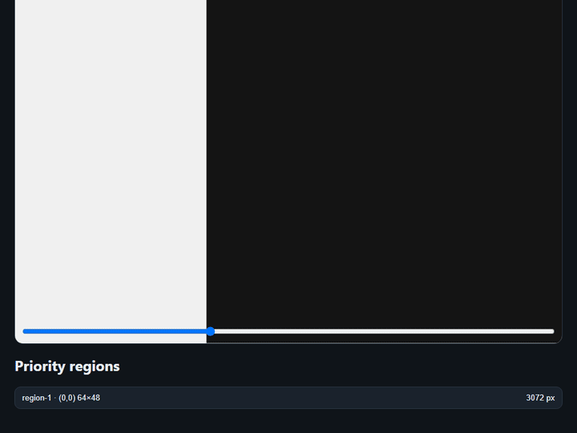

# PixelProof

**Visual feedback for AI-generated interfaces.**

Compare a design reference against a screenshot or a local page URL. PixelProof writes an offline HTML report, `result.json`, and a rule-based `fix-instructions.md` checklist for coding agents.



Local-first · No AI API required · Offline report · Loopback URL capture only

> Status: local `v0.1.0-rc.1`. npm package name is `pixelproof-cli` (CLI binary remains `pixelproof`). Target repo: [flower1201/pixelproof](https://github.com/flower1201/pixelproof). npm publish is not authorized yet.

## Quick start (from source)

Requires Node.js `^22.12.0 || ^24.0.0`.

```bash
npm install
npm run build
npx playwright install chromium   # only needed for --url
```

Image compare:

```bash
node dist/cli/index.js compare \
  --target ./design.png \
  --actual ./screenshot.png \
  --out ./pixelproof-report
```

Local URL (loopback only: `localhost`, `127.0.0.1`, `[::1]`):

```bash
node dist/cli/index.js compare \
  --target ./design.png \
  --url http://127.0.0.1:3000 \
  --viewport 1440x900 \
  --out ./pixelproof-report
```

Open `pixelproof-report/index.html` in a browser for Before/After, Overlay, and Diff.

Fixture smoke test:

```bash
node dist/cli/index.js compare \
  --target ./tests/fixtures/diff-a.png \
  --actual ./tests/fixtures/diff-b.png \
  --out ./examples/out-diff
```

## After npm publish (not yet)

Package name will be `pixelproof-cli`; the CLI command stays `pixelproof`.

```bash
npm i -g pixelproof-cli
pixelproof compare --target ./design.png --actual ./shot.png --out ./pixelproof-report

# or
npx pixelproof-cli compare --target ./design.png --actual ./shot.png --out ./pixelproof-report
```

## Output

```text
pixelproof-report/
├── index.html            # offline Before/After, Overlay, Diff
├── target.png
├── actual.png
├── diff.png
├── result.json
└── fix-instructions.md   # rule-based agent checklist
```

`mismatchRatio` / pixel match numbers measure pixel difference against the reference. They are **not** a design-quality score.

## Development

```bash
npm test
npm run typecheck
npm run build
npm run demo:gif          # regenerate examples/pixelproof-demo.gif
```

## Docs

- [`docs/CLI.md`](./docs/CLI.md) — CLI reference
- [`docs/METRICS.md`](./docs/METRICS.md) — metric definitions
- [`docs/PROJECT_SPEC.md`](./docs/PROJECT_SPEC.md) — engineering baseline
- [`docs/DECISIONS.md`](./docs/DECISIONS.md) — ADRs
- [`CONTRIBUTING.md`](./CONTRIBUTING.md)
- [`SECURITY.md`](./SECURITY.md)

## License

MIT
